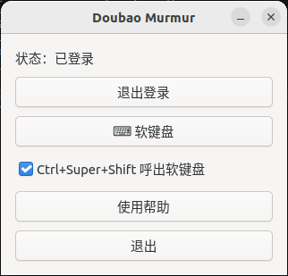
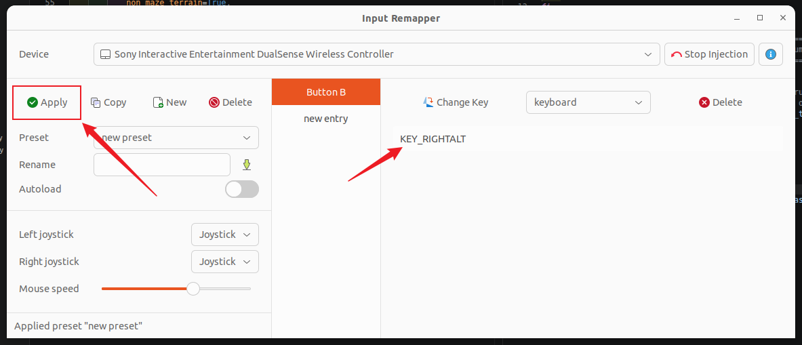
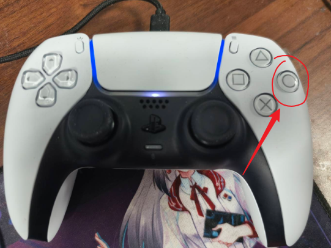
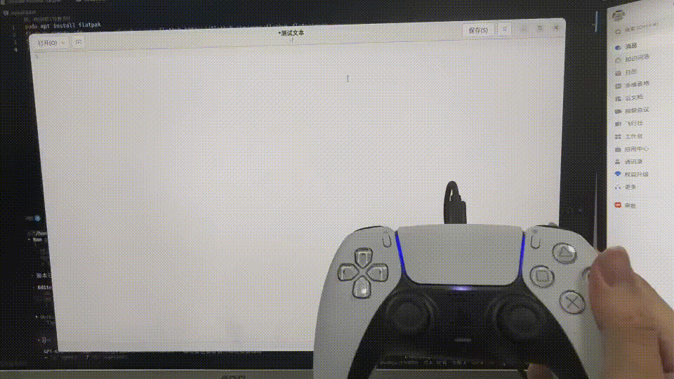

# 豆包语音转文字-省事儿版（Ubuntu 24.04/22.04/20.04 / X11）


## 安装
已经安装好就直接启动：
```bash
flatpak run com.doubao.Murmur
```

首次安装时，在项目目录打开终端，依次运行下面的命令。

```bash
sudo apt install flatpak
flatpak remote-add --user --if-not-exists flathub https://flathub.org/repo/flathub.flatpakrepo
flatpak install --user ./doubao-murmur.flatpak
flatpak run com.doubao.Murmur # 这个是运行指令，找一个cli运行启动应用
```

或者直接运行一键安装脚本：

```bash
./install.bash
```

弹出这个界面登录：



打开应用，点击「登录豆包」。光标放到输入框，按一下右 `Alt` 开始说话，再按一下结束。按 `Ctrl+V` 粘贴文字。

想自动复制粘贴，执行:

```bash
sudo apt install xdotool
```

使用 `PS5` 手柄麦克风时，先用 USB 连接手柄，然后打开 Ubuntu「设置 → 声音 → 输入」，选择手柄麦克风并确认输入音量有反应，再启动应用。应用使用系统当前的默认麦克风；如果列表里没有手柄，请检查连接，或改用 USB 连接。

想用 PS5 手柄按键启停录音，可安装 Input Remapper：`sudo apt install input-remapper`，打开软件，选择 PS5 手柄，将按键映射为 `KEY_RIGHTALT` 并应用。





## 效果



## 结论

可以非常愉快的vibe coding了，直接说就完事儿了，解决了ubuntu没有豆包输入法的困境。

参考自：[github-doubao-murmur](https://github.com/lilong7676/doubao-murmur?utm_source=chatgpt.com)

`doubao-murmur.flatpak` [下载链接](https://github.com/lilong7676/doubao-murmur/releases)